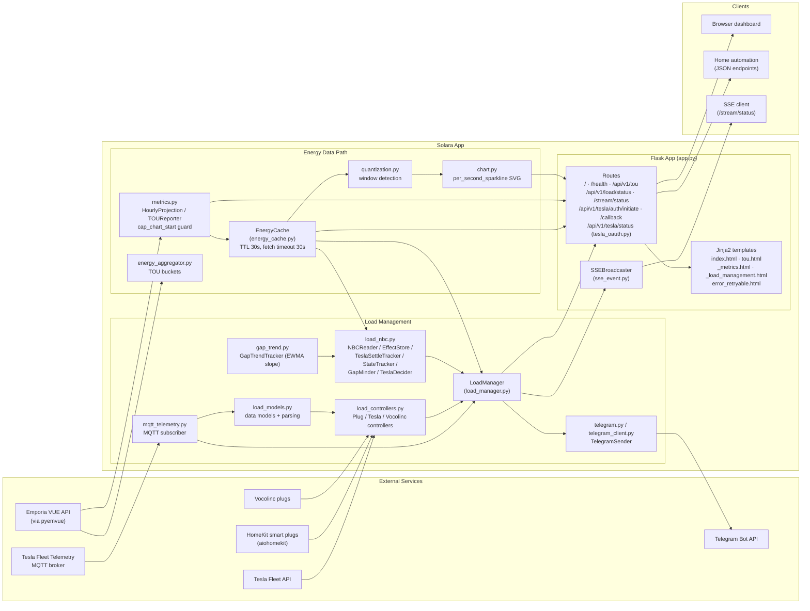
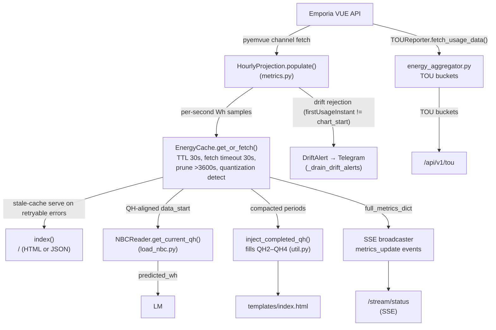
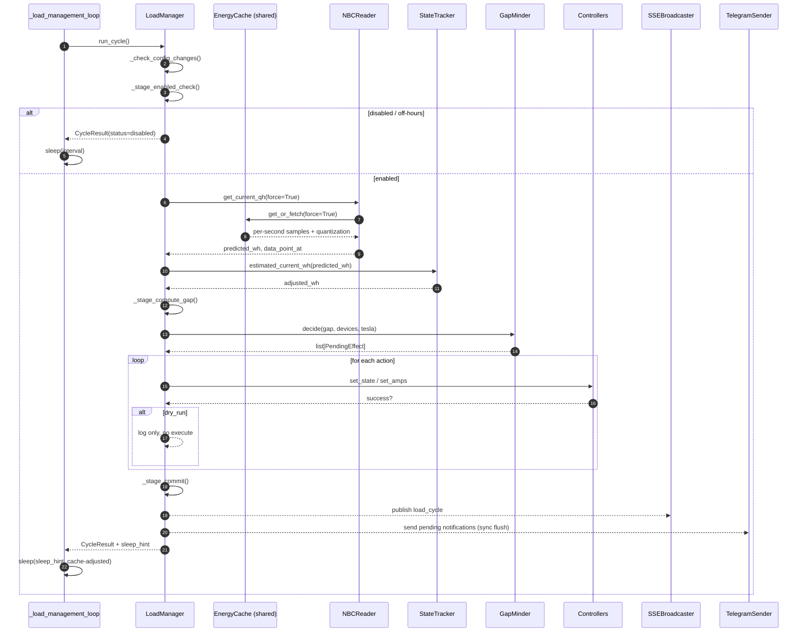
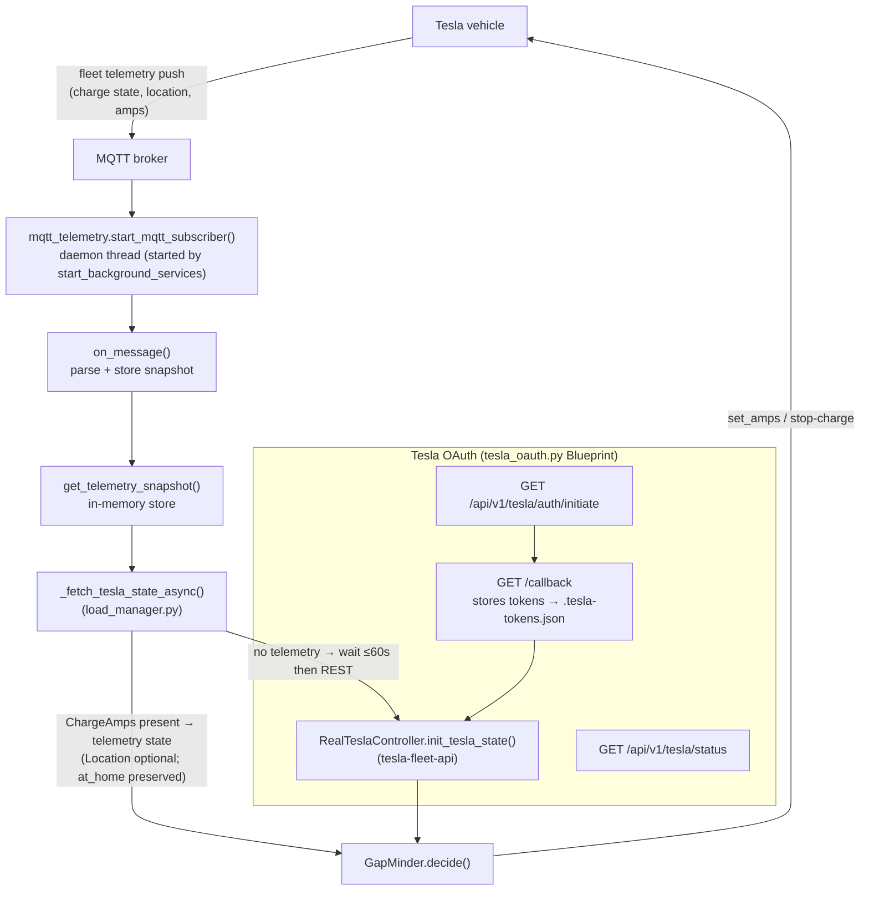
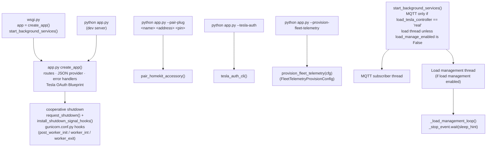

# Solara Architecture Diagrams

Mermaid diagrams describing the Solara system: the Flask web app, the energy
prediction pipeline, and the load management subsystem that controls smart
plugs and Tesla charging to maximize solar self-consumption.

## 1. System Overview

External services on the left (Emporia VUE, Tesla, Telegram) feed data in;
the app's core modules in the middle process it; clients on the right consume
it.

## 2. Metrics / Data Flow (index, TOU, SSE)

The `EnergyCache` is the shared per-second sample store: the web layer, the
NBC reader, and the load manager all read from it. Completed quarter-hours are
compacted into `CompletedNBCPeriod` objects and injected back into
quarter-hour windows (`util.inject_completed_qh`).

## 3. Load Management Cycle

`LoadManager.run_cycle()` runs an eight-step pipeline (stages 0–7) every
~30 seconds on a background thread (or adaptively per `sleep_hint`). Each
stage is an independently testable method; any stage may early-exit with a
`CycleResult`.

```mermaid
flowchart LR
    LOOP["_load_management_loop()<br/>background thread (app.py)"]
    LOOP --> CYCLE["run_cycle()<br/>guarded by self._lock"]

    CYCLE --> S0["0. _check_config_changes()<br/>reload .env / devices.json"]
    S0 --> S1["1. _stage_enabled_check()<br/>disabled / outside time window?"]
    S1 -->|"early exit"| RESULT["CycleResult"]

    S1 -->|"enabled"| S2["2. _stage_nbc_fetch()<br/>NBCReader.get_current_qh(force=True)<br/>→ drains DriftAlerts"]
    S2 -->|"stale / no data"| RESULT
    S2 -->|"predicted_wh"| S3["3. _stage_pending_check()<br/>data-point age vs STALE_DATA_THRESHOLD_SECS<br/>pending effects not yet reflected?"]

    S3 -->|"early exit"| RESULT
    S3 -->|"ok"| S4["4. _stage_compute_gap()<br/>prune old effects,<br/>StateTracker.estimated_current_wh(),<br/>gap = target_wh − adjusted_wh"]

    S4 --> S5["5. _stage_async_phase()<br/>single event loop:<br/>fetch Tesla state (MQTT fast path,<br/>REST fallback) → GapMinder.decide()<br/>→ _execute_action()"]

    S5 --> S6["6. _stage_commit()<br/>sentinel check, persist PendingEffect,<br/>Tesla amp-state tracking,<br/>hysteresis early exit"]
    S6 -->|"early exit"| RESULT
    S6 -->|"ok"| S7["7. _stage_build_result()<br/>candidate details, no-action reason,<br/>CycleResult + sleep_hint"]

    RESULT --> LOOP
    RESULT -->|"camelized payload"| SSE2["SSEBroadcaster.publish('load_cycle')"]
    RESULT -->|"notifications flushed"| NOTIF2["TelegramSender (whitelist-gated)"]
```

## 4. Load Cycle Sequence (detailed)

Shows the interactions between the load manager, the shared energy cache, and
the device controllers for one cycle.

## 5. Tesla Telemetry & State Flow

Fleet telemetry arrives over MQTT; the load manager prefers this fast path
over the REST API and preserves `at_home` across snapshots when `Location` is
missing.

## 6. Entry Points & Background Services

## Data Model Axioms

### Per-second sample contiguity

The `EnergyCache` sample list is **strictly contiguous**: sample `i`
represents exactly the 1-second bucket beginning at
`data_start + timedelta(seconds=i)`, and every bucket is present, non-null,
and finite.

This is an axiom, not a validated invariant. The upstream Emporia API (via
pyemvue `get_chart_usage`) is trusted to return complete, contiguous windows;
interior gaps and null buckets are ruled out by design. Only the window head
is checked (`firstUsageInstant != chart_start` → drift rejection). No
count-vs-span, interior-gap, or null-bucket validation exists anywhere in the
pipeline — by deliberate decision, not oversight.

Code that would be wrong if this axiom were violated (and therefore depends
on it):

- Pruning maps index → time arithmetically (`_prune_old_samples`,
  `sample_time = data_start + i s`).
- Compaction chunks purely by count (`samples[offset:offset+900]`).
- Quarter-hour splitting is count-based (`values_len % 900` in
  `util.compute_nbc_quarters`).
- `_data_lag_secs` is *derived from the sample count*
  (`instant − (data_start + len(samples))` in `metrics.py`), so it measures
  tail freshness only — it cannot reveal interior gaps, and any hypothetical
  gap check built on it would be circular.

If upstream behavior ever changes such that gaps or nulls can appear, revisit
this axiom before adding defensive checks.

# Part 2: Detailed reference

## Key entry points

- **Guard functions** `metrics.py`: `cap_chart_start()`,
  `_chart_start_for()` — cap over-fetching when cache is stale and keep the
  fetch window anchored to a stale QH-aligned `data_start` so a completed QH
  is not lost at a boundary; pure functions, independently tested
- `EnergyCache` in `energy_cache.py` with `get_or_fetch()`, `is_valid()`,
  `sleep_interval_adjust()`, and quantization detection
- NBC calculation in `metrics.py` (`get_current_qh()` helper)
- `HourlyProjection` in `metrics.py` with `populate()` (uses `cap_chart_start`
  guard), `predict()`, and per-device prediction via `_predict_device()`
- TOU in `energy_aggregator.py`
- Load controller factories in `load_controllers.py` (`load_controller_from_env`, etc.)
- `init_tesla_state()` / `_init_from_rest()` in `load_controllers.py` — initializes
  vehicle state from telemetry with REST fallback when initial telemetry is missing
  (waits up to 60 s for telemetry, then falls back to REST API with minimal calls)
- `_is_vehicle_offline_error()` in `load_controllers.py` — detects VehicleOffline
  exceptions from Tesla fleet API; used to downgrade ERROR to WARNING and trigger
  short sleep hint for faster retries
- OAuth in `load_manager.py`
- Tesla callback config dotfile: `.tesla-callback-config` (auto-created, auto-updated)
- Pipeline orchestration in `load_manager.py` (`_stage_enabled_check`, `_stage_nbc_fetch`,
  `_stage_pending_check`, `_stage_compute_gap`, `_stage_async_phase`, `_stage_commit`,
  `_stage_build_result`) — each independently testable. All early exits go through
  the `_early_exit()` builder (shared hysteresis/plugs/tesla/quantization defaults);
  `_stage_pending_check` refreshes the Tesla display plus a pre-gate plug sync
  (`_sync_plugs_for_dashboard` reusing `_sync_plug_states`, so early exits still
  show fresh dashboard pills; carried on `CycleContext` for the async phase to
  reuse — one controller round-trip per plug per cycle); shared queries live in `_local_time()` (device-tz conversion), `_eligible_plugs()`
  (engine-eligible vs out-of-range split), `is_sentinel_on()`, `_is_tesla_in_range()`,
  and `_waiting_sleep_hint()` (prediction-window-capped re-check delay). The async
  phase (`_cycle_async_phase` → `_cycle_async_phase_body`) returns an
  `AsyncPhaseResult` dataclass (named fields, not a tuple) and is split into
  `_async_sync_and_check_sentinel()`, `_record_tesla_auth_error()`,
  `_correct_gap_with_inflight()`,
  `_eligible_for_decision()`, `_decide_actions()`, `_run_actions()`; Tesla
  execute paths share `_mark_vehicle_offline()` + `_handle_tesla_auth_error()`;
  `run_cycle()` stage timings go through `_timed()`
- `_stage_nbc_fetch` in `load_manager.py` — always fetches fresh NBC data
  (`get_current_qh(force=True, ...)` regardless of `ctx.force`). The NBC reader shares the
  app-level `EnergyCache` (wired in `app._get_load_manager()`), whose TTL outlives the
  30 s cycle; a TTL-paced read would cache-hit and skip the fetch, letting data age toward
  the stale-data threshold. The reader's fast path (`get_current_qh` with `force=False`)
  remains for other callers (e.g. `metrics.py`)
- `_stage_compute_gap` in `load_manager.py` feeds `gap_trend.update(...)` with
  the adjusted gap and the `hysteresis / seconds_remaining` noise floor. The
  tracker returns the slope and its trust flag; `ctx.gap_trend_wh_per_s` is the
  slope only while trusted, and the ramp-aware Tesla stop is its only reader
- `_resolve_prediction_window()` / `StateTracker.apply_prediction_window()` — the
  prediction/settle window is adaptive: it resolves lazily from shared-cache
  quantization (quantization data only exists after the first fetch of a cycle) and
  tracks sustained meter-behavior changes. A new window is committed only after two
  consecutive `_stage_compute_gap` calls, and detections within
  `SETTLE_WINDOW_DEADBAND_SECS` (5 s) of the committed window are treated as detector
  jitter (e.g. 29/30/31 s around a true 30 s period). Periods below
  `MIN_QUANTIZATION_WINDOW_SECS` (15 s) — e.g. the flat-data N=2 artifact — are
  rejected by `_resolve_prediction_window` and fall back to the default. The window
  tracks the *quantum* because the meter reports a per-quantum power held constant
  across the quantum (a quantum is too short to measure a real Wh delta), so a window
  equal to the quantum makes the forecast's trailing rate the latest end-of-quantum
  reading — a zero-order hold — and a sub-quantum window is degenerate (identical
  inside one quantum, an aliasing mix across a boundary). Rationale and the
  gate-vs-rate consequence: docs/LOADMANAGER.md
- `_quantization_diagnostics()` in `load_manager.py` — snapshots the current
  quantization state (from the shared `EnergyCache`, refreshed every fetch) plus the
  derived settle window (`StateTracker.effective_settle_secs`); every
  `CycleDiagnostics` construction site folds this in, so each cycle result exposes
  `quantization_seconds`/`quantization_offset`/`quantization_confidence`/
  `settle_window_secs` in the DEBUG cycle-result log (default dataclass repr at
  `app.py` `_load_management_loop`) and the JSON/SSE payloads
  (`/api/v1/load/status`, index, SSE `load_cycle`). None-guarded for stub
  `nbc_reader`s that lack `energy_cache`
- `_fetch_tesla_state_async()` in `load_manager.py` — fetches Tesla state from MQTT
  telemetry with a fast path; `tesla_state_from_snapshot()` requires charging-state
  corroboration (`DetailedChargeState`/`ChargeState`, see `telemetry_indicates_charging()`
  in `load_models.py`) because `ChargeAmps` alone is the pilot setting, not measured
  draw (bugs/2026-09-09-tesla-ghost.log). Preserves `at_home` from `_last_tesla_at_home`
  when `Location` is absent in the snapshot. Two fallbacks before the idle verdict:
  `_commanded_charge_echo()` trusts positive amps under an active command (the car
  answering us; bugs/2026-09-11-tesla-ghost-c.log), and `_arbitrate_tesla_state_from_rest()`
  polls REST `charge_state` for ambiguous (positive, uncorroborated, uncommanded) amps —
  load manager never starts charging itself, so every session begins this way. Polls are
  spaced `TESLA_ARBITRATION_COOLDOWN_SECS` (300 s) apart (definitive answers only — transport failures such as 408 offline leave the timestamp untouched so the next cycle retries instead of latching idle; bugs/2026-10-08-tesla-ghost.log); the verdict is sustained while
  amps stay positive and cleared on amps-zero, corroborated idle, or our own stop command
  (prevents a trim-restart loop). When live telemetry parses to `None` with no echo and
  no arbitration answer, the vehicle is treated as idle/disconnected — a not-charging
  `TeslaState` is returned (`current_amps=0`, `plugged_in=False`, `at_home` from live
  `Location` or `_last_tesla_at_home`) and the controller's stale cached `_init_state`
  is NOT used as an answer (ghost-guard; bugs/2026-08-31-ghost-tesla-amps.log). Delegates
  to controller's `init_tesla_state()` (which waits up to 60 s for telemetry, then REST)
  when telemetry is not yet available or when `at_home` is unseeded and `Location` is
  absent (to seed location). Location-fetch failures preserve the last resolved at_home instead of latching False (bugs/2026-10-08-tesla-ghost.log). `_init_from_rest()` reports `current_amps=0` (not the stale
  pilot) whenever REST `charging_state != "Charging"` (bugs/2026-09-09-tesla-ghost-b.log);
  same zeroing applies to the MQTT `DetailedChargeState`-present path
- Data models in `load_models.py`
- `nominal_voltage()` in `load_nbc.py` — deferred-config resolver for the
  `TESLA_NOMINAL_VOLTAGE` env (default 240; invalid/non-positive falls back
  with a WARNING). All StateTracker amp↔watt conversions and
  `GapMinder.car_power_watts_5a` read it per-call. Do not reintroduce
  import-time voltage constants into conversion math.
- `StateTracker.record_tesla_amp_command()` / `tesla_inflight_wh()` zero-amp
  confirmation (plan 3.5): a single reported 0 A frame does NOT clear
  `last_commanded_amps` — only `TESLA_ZERO_AMPS_CLEAR_SAMPLES` (2)
  consecutive zeros do, and until then the full commanded delta stays
  accounted. The 1 A ramp-up gate credits the unconfirmed portion
  (`commanded − reported`) instead of returning 0. Tests asserting an
  instant clear or a ramp-up zero encode the old bug — do not restore them.
- Shared fleet-telemetry parsing helpers in `load_models.py` (`unwrap_telemetry_value`,
  `parse_charge_amps`) — single home for the `{"value": ...}` envelope unwrap + amps
  rounding, used by `mqtt_telemetry.py` (`on_message`, `tesla_state_from_snapshot`,
  `_compute_at_home_from_location`) and `load_controllers.py` (`_init_from_rest`)
- `_reset_runtime_state()` / `_apply_persisted_tokens()` in `load_controllers.py` —
  shared init paths for `RealTeslaController` (`__init__`/`reset_session` and the
  `_ensure_api` create/update branches respectively)
- `create_app()` factory + routes in `app.py` (module-level `app` singleton; no
  background threads start at import time)
- Cooperative shutdown (single-interrupt exit): `_stop_event` + idempotent
  `request_shutdown(reason)` in `app.py` — sets the stop event every background
  loop waits on (`_load_management_loop` sleeps via `_stop_event.wait()`, not
  `time.sleep()`), wakes SSE streams via `SSEBroadcaster.close_all()`, stops the
  MQTT subscriber (`mqtt_telemetry.stop_mqtt_subscriber()`), and closes the
  LoadManager exactly once. `install_shutdown_signal_hooks()` chains those calls
  over existing SIGINT/SIGQUIT/SIGTERM handlers; wired by `gunicorn.conf.py`
  hooks (`post_worker_init`/`worker_int`/`worker_exit`) and the `__main__`
  block. Rationale: concurrent.futures joins all executor threads (daemon or
  not) at interpreter exit, so a blocked SSE stream used to hang shutdown until
  a second Ctrl-C.
- `start_background_services()` in `app.py` — explicitly starts the MQTT subscriber
  and load-management thread; called from `wsgi.py` and the `__main__` block, never
  at import time (so tests can import the module safely)
- `_setup_file_logging()` in `app.py` — creates `RotatingFileHandler` when `LOG_FILE` is configured
- `_metrics_freshness_payload()` in `app.py` — computes the dashboard
  data-freshness strip (worst device lag + next-update cadence) rendered into
  `_metrics.html`; returns None when no devices. The `live` flag tells the
  client whether SSE is a continuous driver (load management enabled) or a
  one-shot snapshot (keep the server auto-refresh / JS reload timer alive);
  it also selects the mode-aware warn/stale thresholds emitted as
  `data-warn`/`data-stale`.
  Cadence resolution: load-management sleep hint → quantization refresh
  window → `METRICS_UPDATE_FALLBACK_SECS` (120 s)
- Test data generation in `mockdata.py`
- Quantization detection in `quantization.py`
- Timezones in `util.py`
- `CompletedNBCPeriod` in `util.py` — immutable record of a compacted QH period
- `inject_completed_qh()` in `util.py` — fills QH2-QH4 from completed periods
- `compact()` in `energy_cache.py` — compacts completed QH periods into `CompletedNBCPeriod` objects, called after every fetch in `get_or_fetch()`
- `_merge_samples_replace()` in `energy_cache.py` — always-replace fetch path (no overlap merge)
- `EnergyCacheAlignmentError` in `energy_cache.py` — raised by `get_current_qh()` when `data_start`
  is missing or not QH-aligned; a plain `Exception` (asserts are stripped under `python -O`), kept as a
  safety net since the fetch-site drift checks below reject misaligned data before it is stored
- Deferred config in `config.py` (`Config.get()`, `Config.set()`, `_lookup` chain:
  overrides -> os.environ -> .env); config loading helpers in `config_loader.py`
  (`load_tesla_config`, `load_plugs_from_file`, `load_vocolinc_*`)
- Tesla config in `config.py` (`TeslaConfig` dataclass, `load_tesla_config()`)
- Tesla telemetry intervals in `config.py` (`tesla_telemetry_chargestate_interval`,
  `tesla_telemetry_location_interval`, `tesla_telemetry_chargeamps_interval`,
  `tesla_telemetry_detailedchargestate_interval`)
- FleetTelemetryProvisionConfig in `load_models.py` (all interval fields including
  `detailedchargestate_interval_sec`)
- Tesla fleet-telemetry provisioning in `load_controllers.py` (`fleet_telemetry_config_create`)
- DetailedChargeState parsing in `mqtt_telemetry.py` (`tesla_state_from_snapshot`)
- Device config accessors in `device_config.py` (`get_telegram_config`, `get_tesla_config`, etc.)
- Integrity validations in `device_config.py` (`validate_telegram_devices`, `_validate_integrity` — called after every `_load()` to ensure `telegram.devices` keys match plug names)
- Telegram client in `telegram_client.py` (`TelegramClient`, `TelegramConfig`)
- Telegram sender in `telegram.py` (`TelegramSender`, `NotificationEvent`)
- SSE broadcaster and endpoint tests in `tests/test_sse.py` (`SSEBroadcaster`, `event_stream`)
- Pipeline stage tests in `tests/test_pipeline_stages.py`
- CycleContext usage is covered by the pipeline stage tests (`tests/test_pipeline_stages.py`)
- Tesla callback config tests in `tests/test_tesla_callback_config.py`
- Tesla init state tests (telemetry-first, REST fallback) in `tests/test_tesla_init_state.py`
- Tesla command VehicleOffline handling in `tests/test_vehicle_offline_command.py`
- Data-health Telegram alerts (fatal fetch + 300 s meter-stale/no-data +
  prediction-stall with a fresh meter, per-QH throttle each) in
  `tests/test_data_health_alerts.py`
- File logging with rotation tests in `tests/test_file_logging.py` (`_setup_file_logging`)
- Compaction tests in `tests/test_compaction.py` (`CompletedNBCPeriod`, `compact()`, `inject_completed_qh()`, replace-not-merge behavior)

## Actions Generation Flow
- GapMinder.decide() generates actions as a list of PendingEffect objects
- All PendingEffect construction goes through the module factories in load_nbc.py:
  `make_plug_effect()` (applies the signed-power invariant), `make_tesla_set_amps()`,
  `make_tesla_stop()` — no other PendingEffect() call sites remain in load_nbc.py
- Tesla amp logic lives in TeslaDecider (owned by GapMinder as `tesla_decider`):
  `decide_increase()` / `decide_reduce()` / `supports()` / `safe_defer_secs()`.
  The reduction's amp step comes from `TeslaDecider.reduce_amps_for()`, which
  ceils (covers the gap, may overshoot by up to one quantum:
  `volts * R / 3600` Wh). The floor alternative was measured negative and
  removed 2026-10-18 (the residue cannot be closed later because the quantum
  only shrinks with R; verdict above). The increase direction truncates via
  `int`.
  GapMinder keeps thin `_decide_tesla_*` delegates so existing call sites and tests
  keep working. Plug candidate collection is unified in
  `GapMinder._eligible_plugs(ctx, want_on)` (priority order baked in).
- `GapMinder._ordered_candidates` merges plugs and Tesla into one order.
  Tesla joins at `tesla.priority` (default 0) for amp changes only; stop
  decisions ignore it. Equal priorities keep the legacy order (plugs
  first on surplus, Tesla first on deficit), so an unset priority is
  bit-identical. `lumpy_first` reorders plugs only; Tesla is inserted at
  the first position where it outranks a plug.
- The turn-on fit test prices a *starting* load over the whole remaining window
  (`GapMinder._decide_turn_on`): a load may only start if its held cost fits the
  surplus, and the running debit and `estimated_current_wh` are window-priced. The
  dispatch-quantum alternative (one meter dispatch — the minimum dispatch time,
  bounded by the remaining window) was measured a variance trade and removed
  2026-10-18 (verdict above); the whole-window fit stands as a conservative prior
  about whether a small predicted surplus materializes.
- The constructor's opt-in policy knobs (`lumpy_first`, `defer_stop`,
  `max_defer_secs`, `ramp_aware`, `defer_lookahead_quanta`) are keyword-only on
  `GapMinder.__init__`
  (pylint's positional ceiling); the margin and hysteresis knobs stay positional.
  Pinned by tests/test_gap_minder.py. `defer_stop` stays a diagnostic knob
  (measured by `tools/estimator_replay.py --defer`); `max_defer_secs` ships at
  one whole window (`TeslaDecider.MAX_DEFER_SECS` = 900 s, so the gap deadline
  governs and a gap the window cannot pay stops now) and remains overridable
  (`--max-defer-secs`) to reproduce older arms; `ramp_aware` is the production
  flag `LOAD_MANAGER_RAMP_AWARE` (default off), wired through
  `LoadManagerConfig.ramp_aware`. The defer rule is load-bearing (fixed-car
  corpus, 2026-10-21: car-active closed-loop mean |miss| 10.34 on vs 18.12
  off), and
  the cap only helps by not overriding the gap deadline: 120 s 12.21, 300 s
  11.99, 900 s 10.34 (6 quarters better / 0 worse / 135 unchanged at
  120 → 900; plug-only bit-identical). The trend-fold into `safe_defer_secs`
  is not the `t*` predicate (a horizon comparison rather than an exact-hit
  estimate), so no second trend-aware form ships. Cover: tests/test_ramp_aware.py,
  tests/test_tesla_decider.py, tests/test_tesla_ramp_replay.py.
- The defer deadline is sized in observation windows, not seconds:
  `defer_lookahead_quanta` (keyword-only, **default 1 = shipped 2026-10-19**) adds
  that many
  `DecideContext.observability_secs` to `safe_defer_secs`, so a defer never
  leaves less room than the next observation needs. `observability_secs` is the
  quantisation window — production passes the resolved prediction/settle window
  (`state.effective_settle_secs`) and the replay passes each quarter's median
  data-point spacing — and `None` (unknown) leaves the lookahead inert rather
  than guessing. Shipped as a soundness fix priced as a wash (fixed-car
  corpus, 2026-10-21: car-active K=0 10.45, K=1 10.34, 4 quarters improve /
  5 regress at K=1, median delta 0.00, plug-only bit-identical; K=2 10.64,
  K=3 11.29, so the sweep is monotone worse past 1 and 1 stays the rule),
  wired
  through `LOAD_MANAGER_DEFER_LOOKAHEAD_QUANTA` and
  `LoadManagerConfig.defer_lookahead_quanta`; verdict in the tool tree above.
  `0` restores the static rule and reproduces the older verdicts.
  Cover: tests/test_defer_lookahead_quanta.py (the shipped rule, the env
  plumbing, the malformed-value fallback), tests/test_tesla_decider.py
  (`TestDeferQuantumLookahead`), tests/test_estimator_replay.py,
  tests/test_pipeline_stages.py.
- The other R-floor is `constants.MIN_SECONDS_TO_ACT` (21 s — itself a
  hardcoded ≈0.7 × 30, the last quantum-shaped literal in the decision path).
  It gates only the *energizing* directions (plug turn-on
  `GapMinder._decide_turn_on`, Tesla amp increase
  `TeslaDecider.decide_increase`) — never turn-off or the last-resort Tesla
  stop, which are deliberately unguarded — so the defer lookahead does not
  need to cover it: the two floors are independent consumers of "is there
  enough room left". Whether `MIN_SECONDS_TO_ACT` should also be derived from
  the quantum (it is too small for a 60 s meter and over-strict for a 15 s
  one) is an unmeasured question, not a shipped change.
- In run_cycle(), raw NBC predictions are adjusted with pending effect deltas via
  `estimated_current_wh()` before being passed to decide() — this accounts for
  actions already taken this quarter-hour without waiting for fresh API data
- Actions are determined by comparing adjusted predicted_wh against target_wh (default -50 Wh)
- Three action types: "turn_on", "turn_off", "set_amps"
- Algorithm uses bin-packing to fit eligible loads into the surplus gap
- Both directions aim at the target: `decide()` passes `gap - TURN_ON_MARGIN_WH`
  (default 0) to `_decide_turn_on` via `_turn_on_budget()` and
  `abs_gap - TURN_OFF_MARGIN_WH` (default 0) to `_decide_turn_off` via
  `_turn_off_budget()`; pass `turn_on_margin_wh=hysteresis_wh` or
  `turn_off_margin_wh=hysteresis_wh` to restore the old deadband-edge
  behavior. Covered by tests/test_turn_on_aim.py and tests/test_turn_off_aim.py;
  the edge-mode plug case lives in tests/test_gap_minder.py as
  `test_edge_gap_reduces_surplus_turn_on` and the edge-mode Tesla case as
  `test_edge_gap_reduces_tesla_amps_reduction`.
- Turn-off shedding is deliberately unguarded (design decision, not an
  oversight): no MIN_SECONDS_TO_ACT floor and no overshoot cap —
  `_decide_turn_off` turns plugs off until `remaining_reduction <= 0`, even
  for negligible in-quarter savings near the QH boundary. Asserted by
  tests/test_gap_minder.py; do not add turn-off guards without revisiting
  this decision.

## Index Endpoint
- `index()` in app.py serves HTML or JSON based on Accept header
- Static assets (`static/style.css`, `static/app.js`) are referenced with
  **relative paths** (not `url_for` absolute paths) so the dashboard works
  behind a transparent nginx proxy that mounts the app under a path prefix
  (e.g. `/solara/`); the SSE `?partial=` fetches in `app.js` are likewise
  relative
- Returns model.metrics which includes:
  - devices: list with gid, lag, name, prediction, nbc (clock-boundary quarter-hour data),
    prev_hour_data
  - api_response: timing info
  - instant: timestamp
- Template templates/index.html displays NBC QH1-QH4 values with dynamic time-range labels,
  minute/hour usage, predictions
- The metrics section (`_metrics.html`) opens with a data-freshness strip
  (`#data-freshness`): worst device lag + next-update cadence, ticked by
  `static/app.js`; status colors fresh → aging → stale against mode-aware
  thresholds in `constants.py` — `FRESHNESS_RELOAD_WARN/STALE_SECS` (300/420,
  load management disabled) and `FRESHNESS_LIVE_WARN/STALE_SECS` (180/300,
  load management enabled), emitted as `data-warn`/`data-stale` so the client
  ticks with the same values. Its `data-live` flag ("1" when load management
  is enabled) tells the SSE client whether to cancel page auto-refresh
  (continuous driver) or keep the meta refresh / JS reload timer (one-shot
  snapshot)
- The legacy "Load Management" section (`_load_management.html`,
  `#load-management-section`) is kept but only **displayed when debug mode is
  enabled** (`metrics.debug` in the full page; `metrics_data["debug"]` gates
  the `/?partial=load` fragment). Load management itself keeps running and the
  freshness strip still drives live SSE updates regardless — the section is a
  diagnostics view, not the live driver

## Device State Tracking
- EffectStore class (load_nbc.py) owns the pending-effects list with its own
   RLock: `add()`, `snapshot()`, `has_since()` / `count_since()` (window-buffered
   freshness checks), `prune()` (dual wall-clock + data-point age), `latest_for()`,
   `clear_tesla_set_amps()`. StateTracker keeps a `pending_effects` property for
   backward compat plus thin delegating methods.
- TeslaSettleTracker class (load_nbc.py) owns the in-flight Tesla amp command
   (`last_commanded_amps`, zero-sample confirmation): `record_command()`,
   `inflight_wh()` (with `_inflight_zero()` / `_inflight_one_amp()` helpers),
   `get_active()` / `is_settling()` sharing one `_find_active()` lookup
   (dual wall-clock + data-point age, QH-boundary expiry). StateTracker keeps
   a `last_commanded_amps` property plus delegating `tesla_inflight_wh()`,
   `record_tesla_amp_command()`, `get_active_tesla_settle()`, `is_settling()`,
   and syncs the adaptive window into both stores via `apply_prediction_window`.
- StateTracker class (load_nbc.py) maintains:
   - devices: dict[str, DeviceState] - desired/actual state, current_amps, last_toggle
   - pending_effects: list[PendingEffect] - actions taken since last NBC data point,
     pruned when fresh data arrives via `prune_old_effects()`
   - last_data_point_at, last_nbc_predicted_wh
   - registered: bool - whether Tesla callback is registered via dotfile
- Key methods:
  - `estimated_current_wh()`: adjusts raw NBC prediction with pending effect deltas
  - `has_pending_effect_since()`: checks if any action was taken after given timestamp
  - `pending_since_count()`: counts effects after a given timestamp (for diagnostics)
  - `prune_old_effects()`: removes effects older than cutoff to prevent unbounded growth; pruning the last Tesla `set_amps` effect also clears the orphaned `last_commanded_amps` (bugs/2026-10-08-weird-behavior.log)
  - `apply_prediction_window()`: resolves the prediction/settle window from shared-cache
    quantization; commits a new window only after two consecutive cycles and ignores
    dead-band jitter (see `_resolve_prediction_window`)
- DeviceState dataclass tracks per-device runtime state, including daily
  ON-time fields (`on_since`, `runtime_today_secs`, `runtime_day`) credited by
  `StateTracker.note_desired_transition()` (single funnel for GapMinder
  decisions and `_sync_plug_states` reconciliation; meter-local midnight
  resets/clips) and read via `runtime_today_for()` for alerts only
- Dashboard pills (`templates/_metrics.html`) show `pending-on/off` (faded)
  while a pending effect exists, else fall back to unconfirmed `desired_state`
  mismatch (desired=True/actual=False → pending-on, desired=False/actual=True
  → pending-off) so pruning before controller confirmation never flaps to
  off/on; `_sync_plug_states` (`load_manager.py`) credits a mismatch to our own
  command for one observation window (`_command_may_be_in_flight`, sized from
  `effective_settle_secs`), then adopts the reported state so a command the
  plug never reported cannot hold `desired_state` forever. Covered by
  `tests/test_desired_pending.py` and `tests/test_sync_external_effect.py`.
- Stale detection uses **data-point age** (not fetch time): `data_point_at = fetched_at - timedelta(seconds=data_lag_secs)`.
  The threshold is `STALE_DATA_THRESHOLD_SECS` (80 seconds, constants.py) from the most
  recent per-second data point, accounting for Emporia API lag. Min toggle interval: 60 seconds.

## EnergyCache & Incremental Fetch

Sample contiguity and its consequences: see "Per-second sample contiguity" above.

- `EnergyCache` (energy_cache.py) stores per-second energy samples with metadata in a
  frozen `EnergyCacheData` dataclass:
  - `samples`: list[float] — per-second Wh values
  - `data_start`: datetime — start time of the sample window
  - `sample_count`, `last_sample_at`: metadata for diagnostics
  - `full_metrics_dict`: dict[str, Any] | None — metrics dict refreshed on every fetch (not just the first),
    returned on cache hits to preserve keys like `devices`, `nbc`, `instant`
- `_fetch_channel_data()` in `metrics.py` (HourlyProjection) — rejects a drifted API
  `data_start` (`firstUsageInstant != requested chart_start`) by raising
  `RetryableMetricsException` before any misaligned data is stored; `_run_fetch_with_timeout`
  logs it as transient ("will retry"), `get_or_fetch` serves stale cache, and the next cycle
  refetches (quiet self-heal).  Persistent drift — the same `(channel_num, chart_start)`
  key rejected `DRIFT_REJECTION_ALERT_AFTER` (5) consecutive fetches — escalates: an
  ERROR-level log plus a one-time `DriftAlert` event per QH key, drained by
  `LoadManager._drain_drift_alerts()` (called by `run_cycle` after the NBC fetch stage)
  which queues a Telegram error notification via `_queue_drift_error_notification()`
  (bypasses the devices whitelist; fires whenever a `TelegramSender` is configured).
  `metrics.drain_drift_alerts()` returns/clears the pending alert events.
- `_merge_samples_replace(existing, new_data)`: replaces existing samples with new
  data (always-replace, no overlap merge), updating metadata.
- `_prune_old_samples()`: removes samples older than 3600 seconds from `now` to prevent
  unbounded memory growth. Called automatically by `get_or_fetch()`.
- `get_or_fetch(fetcher, force=False)`: returns cached data if valid (within TTL), otherwise
  calls the fetcher. Fetch results replace the cached samples (no overlap merge). On cache
  hits, returns the full metrics dict (including `devices`) if stored from a prior fetch.
  Always updates `full_metrics_dict` on every fetch to keep predictions current.

## Key Architecture
- LoadManager orchestrates cycles every 30 seconds via background thread, calling `run_cycle(force=False)` by default.
- EnergyCache stores per-second samples in a sliding window; NBCReader reads QH predictions from it with `get_current_qh(force=False)`. After compaction, completed QH periods are stored as immutable `CompletedNBCPeriod` objects and per-second data only covers the current incomplete QH.
- Controllers: PlugController (stub) / RealPlugController (aiohomekit), TeslaController (stub) / RealTeslaController (tesla-fleet-api)
- Plugs configured via LOAD_PLUG_<NAME>=<accessory_id>:<power_watts>[:<priority>] env vars

## Authentication & Error Handling
- **Emporia VUE API**: Auth tokens (access, id, refresh) are stored in `.vue-keys.json` at the project root. The `Metrics` class reads this file to authenticate via `pyemvue`. This file contains sensitive credentials and must never be committed.
- **Retryable Errors**: A custom `RetryableMetricsException` triggers an auto-refreshing error page (5-second refresh) when the Emporia API returns server errors.

## File → Module Map

| Concern | Module |
|---|---|
| Flask app, routes, background loops, cooperative shutdown | `app.py` |
| Gunicorn entry point + shutdown hooks (timeout = 60) | `wsgi.py`, `gunicorn.conf.py` |
| Energy fetch & hourly prediction, drift rejection | `metrics.py` |
| Per-second sample cache (TTL 30s, fetch timeout 30s) | `energy_cache.py` |
| Server-side per-second sparkline SVG | `chart.py` |
| TOU aggregation | `energy_aggregator.py` |
| NBC reading, EffectStore / TeslaSettleTracker / StateTracker, TeslaDecider + GapMinder bin-packing | `load_nbc.py` |
| Gap EWMA slope tracker (ramp-aware Tesla stop) | `gap_trend.py` |
| Load cycle orchestration, OAuth, notifications queue | `load_manager.py` |
| Device controllers (HomeKit, Tesla, Vocolinc), factories | `load_controllers.py` |
| Vocolinc cloud API client | `vocolinc.py` |
| Shared data models, telemetry parsing helpers | `load_models.py` |
| Tesla MQTT telemetry parsing | `mqtt_telemetry.py` |
| Quantization detection | `quantization.py` |
| Named magic-number constants | `constants.py` |
| Structured log formatting | `logfmt.py` |
| SSE broadcaster | `sse_event.py` |
| Telegram notifications | `telegram.py`, `telegram_client.py` |
| Deferred config, Tesla/Plug config dataclasses | `config.py`, `config_loader.py` |
| devices.json loader & integrity validation | `device_config.py` |
| Quarter-hour helpers, compaction records | `util.py` |
| Tesla OAuth Blueprint (`/api/v1/tesla/auth/initiate`, `/callback`, `/api/v1/tesla/status`) | `tesla_oauth.py` |
| FakeClock / Clock protocol | `clock.py` |
| Test data generation | `mockdata.py` |
| Templates | `templates/` |
| Tests | `tests/` |
